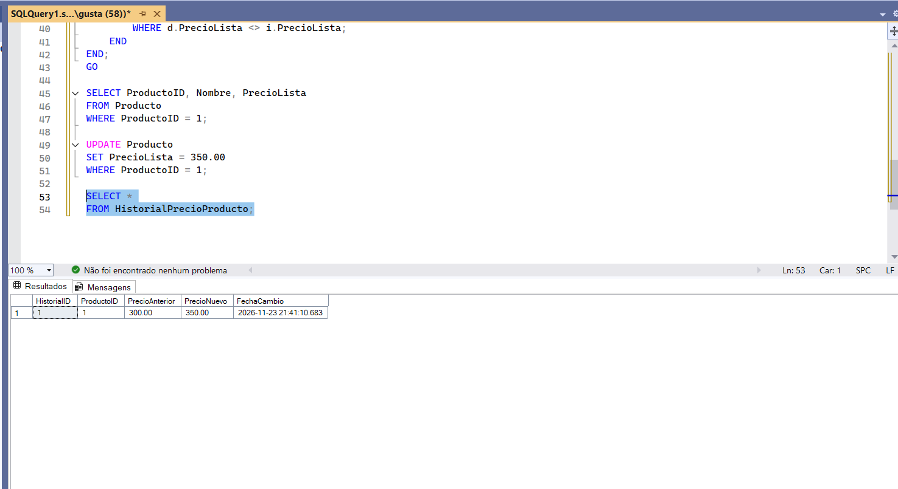
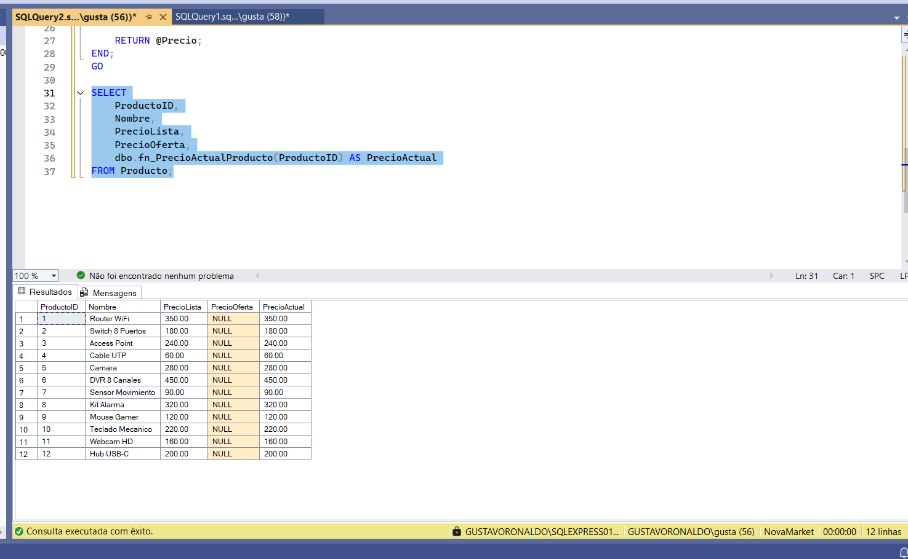

# PA4 - Programación Avanzada de Base de Datos

## Caso: NovaMarket

En mi parte del trabajo desarrollé las **Actividades 1 y 2**, utilizando la base de datos `NovaMarket`.

---

## Actividad 1 - Automatización mediante desencadenantes

Se implementó un trigger para registrar automáticamente los cambios realizados en el precio de los productos.

Para ello se creó la tabla:

`HistorialPrecioProducto`

Esta tabla almacena:

- `HistorialID`
- `ProductoID`
- `PrecioAnterior`
- `PrecioNuevo`
- `FechaCambio`

El trigger utilizado es:

`trg_HistorialPrecioProducto`

El trigger se ejecuta después de realizar un `UPDATE` sobre la tabla `Producto`.

Para registrar correctamente el cambio se utilizan las tablas virtuales:

- `deleted`: permite obtener el precio anterior.
- `inserted`: permite obtener el nuevo precio.

### Prueba realizada

Se modificó el precio del producto con `ProductoID = 1`.

- Precio anterior: `300.00`
- Precio nuevo: `350.00`

El cambio fue registrado automáticamente en la tabla `HistorialPrecioProducto`.

### Evidencia

### Archivo

`01_actividad1_trigger.sql`

---

## Actividad 2 - Funciones en SQL Server

Se desarrollaron dos funciones relacionadas con los productos de NovaMarket:

1. Una función escalar.
2. Una función de tipo tabla.

### Función escalar

Nombre:

`dbo.fn_PrecioActualProducto`

Esta función recibe un `ProductoID` y devuelve un único valor correspondiente al precio actual del producto.

La lógica utilizada es:

- Si el producto tiene `PrecioOferta`, devuelve ese valor.
- Si `PrecioOferta` es `NULL`, devuelve `PrecioLista`.

### Evidencia de la función escalar

---

### Función de tipo tabla

Nombre:

`dbo.fn_ProductosPorCategoria`

Esta función recibe un `CategoriaID` y devuelve los productos que pertenecen a dicha categoría.

La función devuelve:

- `ProductoID`
- `Nombre`
- `PrecioLista`
- `PrecioOferta`
- `Stock`

Para la prueba se utilizó:

`CategoriaID = 1`

Como resultado se mostraron los productos correspondientes a la categoría **Redes**.

### Evidencia de la función de tipo tabla

### Diferencia entre las funciones

La **función escalar** devuelve un solo valor y es útil cuando se necesita obtener o calcular un dato específico.

La **función de tipo tabla** devuelve varias filas y columnas, por lo que es útil cuando se necesita reutilizar una consulta que devuelve un conjunto de registros.

### Archivo

`02_actividad2_funciones.sql`

---

## Archivos de mi parte

- `00_esquema_y_datos_base.sql`
- `01_actividad1_trigger.sql`
- `02_actividad2_funciones.sql`

---

## Orden de revisión

1. Ejecutar `00_esquema_y_datos_base.sql` para crear la base de datos `NovaMarket`.
2. Ejecutar `01_actividad1_trigger.sql`.
3. Revisar la prueba de actualización de precio y la tabla `HistorialPrecioProducto`.
4. Ejecutar `02_actividad2_funciones.sql`.
5. Ejecutar las consultas de prueba de la función escalar y de la función de tipo tabla.

---

## Responsable

**Gustavo Munoz Izquierdo - Actividades 1 y 2**
