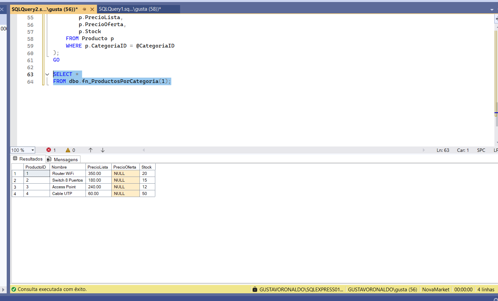
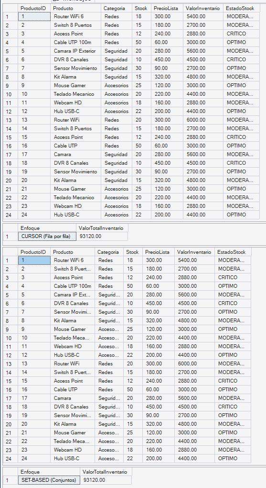
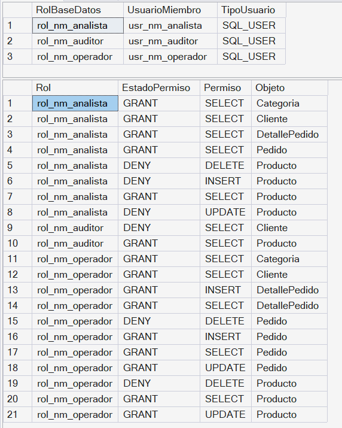

# 🛒 Proyecto NovaMarket — Evaluación Aplicada (PA4)


- **Evaluación:** Proceso de Aprendizaje 4 (PA4) — Sesiones 11 a 13
- **Curso:** 30627 - Programación Avanzada de Base de Datos
- **Institución:** ISIL - Educación Superior
- **Caso aplicado:** NovaMarket (continuidad progresiva del esquema de clientes, productos y pedidos en SQL Server)
- **Docente:** Wilder Julio Espinoza Bravo

---

## 👥 Integrantes y Roles del Equipo

| Integrante                          | Usuario GitHub                                                 | Rol y Participación en PA4                                                                                                                                                                                                                                       |
| :---------------------------------- | :------------------------------------------------------------- | :--------------------------------------------------------------------------------------------------------------------------------------------------------------------------------------------------------------------------------------------------------------- |
| **Gustavo Ronaldo Muñoz Izquierdo** | [@GustavoRonaldinho67](https://github.com/GustavoRonaldinho67) | **Actividades 1 y 2:** Esquema base (`NovaMarket`), desencadenante `AFTER UPDATE` con `deleted`/`inserted`, función escalar, función de tipo tabla y evidencias 1–3.                                                                                             |
| **Mauricio Rojas Arias**            | [@chunchope](https://github.com/chunchope)                     | **Actividades 3 y 4 + QA & Integración:** Cursor y evaluación crítica frente a consulta _set-based_, configuración de autenticación/usuarios/roles/permisos, pruebas de acceso, revisión QA de scripts, organización de carpetas y consolidación de `README.md`. |

---

## 📂 Estructura del Repositorio

```text
/
├── README.md
├── sql/
│   ├── 00_esquema_y_datos_base.sql
│   ├── 01_actividad1_trigger.sql
│   ├── 02_actividad2_funciones.sql
│   ├── 03_actividad3_cursor.sql
│   └── 04_actividad4_seguridad.sql
└── evidencias/
    ├── Evidencia_01_Trigger_Historial_Precios.png
    ├── Evidencia_02_Funcion_Escalar.png
    ├── Evidencia_03_Funcion_Tabla.png
    ├── Evidencia_04_Cursor_vs_SetBased.png
    └── Evidencia_05_Seguridad_Roles_Pruebas.png
```

---

## 🏢 Descripción del Problema Organizacional

La organización (contextualizada en la base de datos `NovaMarket`) administra clientes, productos y pedidos en Microsoft SQL Server. Para el corte de las sesiones 11 a 13 se requiere resolver cuatro necesidades operativas directamente en el servidor:

1. **Auditoría automática de cambios:** registrar automáticamente las modificaciones en el precio de los productos sin depender de las aplicaciones cliente.
2. **Reutilización de lógica en el servidor:** encapsular cálculos puntuales (precio vigente) y consultas parametrizadas (productos por categoría) mediante funciones.
3. **Evaluación crítica de cursores:** implementar un cursor sencillo y contrastarlo objetivamente frente a una consulta basada en conjuntos (_set-based_) para decidir cuál conviene en producción.
4. **Control de acceso diferenciado:** configurar autenticación, usuarios y roles bajo el principio de privilegios mínimos, comprobando accesos permitidos y denegados.

---

## 🎯 Objetivo

Integrar desencadenantes, funciones escalares y de tipo tabla, análisis crítico de cursores y controles de acceso de Microsoft SQL Server (sesiones 11, 12 y 13) para lograr una base de datos automatizada, reutilizable, eficiente y segura.

---

## 🛠️ Desarrollo y Estrategia Adoptada

- **Sesión 11 (Desencadenantes):** creación de `HistorialPrecioProducto` y el trigger `AFTER UPDATE` sobre `Producto`, cruzando `deleted` e `inserted` para soportar actualizaciones de una o múltiples filas.
- **Sesión 12 (Funciones y Cursores):** creación de una función escalar y una función de tabla _inline_; implementación de un cursor `LOCAL FAST_FORWARD` comparado contra una consulta _set-based_ con `STATISTICS IO/TIME`.
- **Sesión 13 (Seguridad):** definición de 3 perfiles diferenciados con autenticación SQL Server, roles personalizados (`rol_nm_*`), permisos `GRANT`/`DENY` y validación con `EXECUTE AS USER`.
- **Control QA:** estandarización de idempotencia (`IF DB_ID`, `IF OBJECT_ID`, `CREATE OR ALTER`) para que todos los scripts puedan ejecutarse en orden sin errores en cualquier instancia de SQL Server.

---

## 💻 Solución Propuesta (Detalle Técnico por Actividad)

### 📌 Actividad 1 — Automatización mediante Desencadenantes (`sql/01_actividad1_trigger.sql`)

- **Objetos creados:** tabla `HistorialPrecioProducto` (con `FK` hacia `Producto`) y trigger `trg_HistorialPrecioProducto` (`AFTER UPDATE`).
- **Mecanismo `deleted` / `inserted`:** valida `IF UPDATE(PrecioLista)` y une `deleted` (precio anterior) con `inserted` (precio nuevo) filtrando `WHERE d.PrecioLista <> i.PrecioLista`.
- **Justificación:** un desencadenante es el objeto adecuado porque garantiza trazabilidad automática ante cualquier `UPDATE`, independientemente de la aplicación o usuario que modifique el precio.
- **Prueba ejecutada:** se actualizó el `PrecioLista` del `ProductoID = 1` de `300.00` a `350.00`, generándose el registro automático en `HistorialPrecioProducto`.

### 📌 Actividad 2 — Funciones Escalares y de Tipo Tabla (`sql/02_actividad2_funciones.sql`)

- **Función Escalar (`dbo.fn_PrecioActualProducto`):** recibe `@ProductoID` y retorna `DECIMAL(10,2)` devolviendo `PrecioOferta` si existe o `PrecioLista` si es `NULL`.
- **Función de Tipo Tabla (`dbo.fn_ProductosPorCategoria`):** recibe `@CategoriaID` y retorna el conjunto de productos de la categoría (`CategoriaID = 1` → Redes).
- **Comparación funcional:**

| Criterio        | Función Escalar (`fn_PrecioActualProducto`)             | Función de Tipo Tabla (`fn_ProductosPorCategoria`)               |
| :-------------- | :------------------------------------------------------ | :--------------------------------------------------------------- |
| **Retorno**     | Un único valor escalar (`DECIMAL(10,2)`).               | Conjunto de filas y columnas (`TABLE`).                          |
| **Consumo**     | En `SELECT`, `WHERE` o asignaciones `SET`.              | En la cláusula `FROM` (como una vista parametrizada).            |
| **Pertinencia** | Cálculos puntuales sobre un valor o columna individual. | Reutilizar consultas filtradas que retornan múltiples registros. |

### 📌 Actividad 3 — Cursor y Evaluación Crítica de Alternativas (`sql/03_actividad3_cursor.sql`)

- **Caso implementado:** valorización del inventario activo (`Stock * PrecioLista`), clasificación de reposición (`CRITICO`, `MODERADO`, `OPTIMO`) y suma del valor total.
- **Cursor implementado:** `cur_ValorizacionInventario` (`LOCAL FAST_FORWARD`), recorriendo fila por fila con `DECLARE → OPEN → FETCH NEXT → WHILE @@FETCH_STATUS = 0 → CLOSE → DEALLOCATE`.
- **Alternativa comparada:** consulta _set-based_ con `INNER JOIN`, `CASE` y `SUM()`.
- **Análisis comparativo (Ventajas, desventajas e implicancias):**

| Dimensión         | Cursor (Fila por fila)                                    | Alternativa Set-Based (Conjuntos)               |
| :---------------- | :-------------------------------------------------------- | :---------------------------------------------- |
| **Rendimiento**   | Bajo en grandes volúmenes; procesa fila por fila.         | Alto; el optimizador procesa bloques completos. |
| **Memoria**       | Mayor consumo por mantener el cursor y variables activas. | Menor uso de memoria y mejor gestión interna.   |
| **Bloqueos**      | Mayor riesgo de retención de bloqueos en concurrencia.    | Mínimo tiempo de bloqueo sobre las tablas.      |
| **Complejidad**   | Más código y riesgo de omitir `CLOSE`/`DEALLOCATE`.       | Código declarativo, corto y fácil de mantener.  |
| **Escalabilidad** | Se degrada conforme aumenta la cantidad de filas.         | Escala eficientemente con índices adecuados.    |

- **Conclusión de la Actividad 3:** para valorización, cálculos y reportes **no conviene usar cursores**; la consulta _set-based_ entrega el mismo resultado con mejor rendimiento y escalabilidad. El cursor solo se justifica cuando es estrictamente obligatorio ejecutar lógica procedimental individual por cada fila.

### 📌 Actividad 4 — Autenticación, Usuarios, Roles y Seguridad (`sql/04_actividad4_seguridad.sql`)

- **Tipo de autenticación:** **Autenticación de SQL Server (Modo Mixto)**, adecuada para separar cuentas de aplicación/operación de las cuentas de Windows y administrar políticas desde el motor.
- **Matriz de perfiles y privilegios mínimos:**

| Perfil                 | Login / Usuario BD                      | Rol Personalizado | Permisos (`GRANT`)                                                                                     | Restricciones (`DENY`)                                                              |
| :--------------------- | :-------------------------------------- | :---------------- | :----------------------------------------------------------------------------------------------------- | :---------------------------------------------------------------------------------- |
| **Analista Comercial** | `login_nm_analista` / `usr_nm_analista` | `rol_nm_analista` | `SELECT` en tablas de negocio y consumo de funciones S12.                                              | `DENY INSERT, UPDATE, DELETE` en `Producto`.                                        |
| **Operador de Ventas** | `login_nm_operador` / `usr_nm_operador` | `rol_nm_operador` | `SELECT/UPDATE` en `Producto`; `SELECT/INSERT/UPDATE` en `Pedido`; `SELECT/INSERT` en `DetallePedido`. | `DENY DELETE` en `Producto` y `Pedido`; sin escritura en `HistorialPrecioProducto`. |
| **Auditor de Precios** | `login_nm_auditor` / `usr_nm_auditor`   | `rol_nm_auditor`  | `SELECT` en `Producto` y `HistorialPrecioProducto`.                                                    | `DENY SELECT` en `Cliente`; sin escritura en auditoría.                             |

- **Pruebas de acceso:** 6 validaciones automatizadas con `EXECUTE AS USER`, `TRY...CATCH` y `REVERT` comprobando accesos permitidos y denegados.
- **Propósito de claves y certificados (Sesión 13):**
  - **Claves de cifrado (simétricas y asimétricas):** protegen la confidencialidad de datos sensibles almacenados en la base de datos frente a accesos no autorizados.
  - **Certificados:** objetos basados en criptografía asimétrica usados para autenticar identidades, firmar objetos, cifrar comunicaciones y proteger claves simétricas.
  - **Jerarquía de claves:** _Windows DPAPI → Service Master Key (SMK) → Database Master Key (DMK) → Certificados / Claves Simétricas y Asimétricas_.
  - **Respaldo:** respaldar la DMK y los certificados en una ubicación segura externa es crítico para poder recuperar datos cifrados ante fallos o migraciones.

---

## ⚙️ Cómo Ejecutar y Revisar el Proyecto

### Requisitos

- Microsoft SQL Server (2016 o superior) y SQL Server Management Studio (SSMS) con permisos administrativos para ejecutar la Actividad 4.

### Orden estricto de ejecución

1. `sql/00_esquema_y_datos_base.sql`
2. `sql/01_actividad1_trigger.sql`
3. `sql/02_actividad2_funciones.sql`
4. `sql/03_actividad3_cursor.sql`
5. `sql/04_actividad4_seguridad.sql`

---

## 📸 Evidencias de Ejecución

### Actividad 1 — Desencadenante de Historial de Precios


### Actividad 2 — Función Escalar y Función de Tipo Tabla




### Actividad 3 — Cursor vs. Alternativa Set-Based



### Actividad 4 — Roles, Permisos y Pruebas de Acceso



---

## 📌 Conclusiones

1. El trigger `AFTER UPDATE` con `deleted` e `inserted` asegura auditoría automática de precios sin depender del cliente.
2. Las funciones escalares y de tabla modularizan reglas y consultas reutilizables directamente en el servidor.
3. Contrastar un cursor con una consulta _set-based_ confirma que el enfoque basado en conjuntos es superior en rendimiento, memoria y escalabilidad.
4. Aplicar privilegios mínimos mediante roles personalizados y comprender la jerarquía de claves y certificados fortalece la seguridad integral de `NovaMarket`.

---
